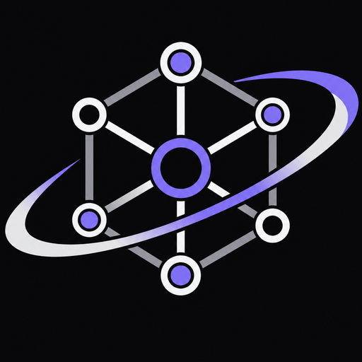

<p align="center"></p>

# GraphHelm

**Orchestrate coding agents around the user journeys a change affects, and see the evidence that those journeys still work.**

GraphHelm is for developers who hand software work to AI coding agents (Claude Code, Codex) and need to know whether the result actually works for a user. It links three things that usually live in different places: the request you made, the issues and pull requests agents produce for it, and the journey runs that show the affected flows working, step by step, with captured screens and history.

A merge, a green build or an agent saying "done" is not treated as proof. A request reads as proven only when its journeys passed their last run.

[Quick start](#quick-start) · [Install in your project](INSTALL.md) · [Studio](apps/studio/README.md) · [Journeys guide](docs/guides/journeys.md) · [Documentation](docs/INDEX.md)

**Experimental · runs on your machine · MIT licensed.** There is no stable release yet; expect a developer-oriented setup and changing interfaces. See [status and limitations](#status-and-limitations).

<!-- No checked-in screenshot of the current Proof view exists yet. Add one under docs/assets/
     from a real run before linking it here; do not use design mock-ups as evidence. -->

## The problem

Delegating a multi-step change to agents raises questions a chat transcript does not answer:

- Which issues and PRs belong to my request, and what is still open or blocked?
- Which agent is doing what, and which one is waiting on me?
- Does the flow the user actually goes through still work, at this commit, and how do I know?
- If it broke, at which step, and what changed compared to the last time it worked?

GraphHelm answers them from recorded events and journey runs, not from what an agent reports.

## How a change flows

Using GraphHelm in your own project:

1. **Request.** You ask for a change in your agent host (for example "let users reset their password"). The work is recorded as one request.
2. **Agents work.** Agents open issues and pull requests for it. Each runs as a lane you can follow; a question an agent asks waits for your answer instead of being guessed.
3. **Journeys define the promise.** The user-visible promise is written as a journey: `.graphhelm/journeys/<id>.journey.yaml`, a small graph of screens (observable states) and edges (the acts between them), with explicit checks on each screen. A journey is a draft until you, the owner, approve it.
4. **Journeys run.** An approved journey is replayed at the committed head without a model call: in a real browser through the Playwright observer, or as `cli`/`http` acts for backends.
5. **You inspect the evidence.** Each step shows its result, the checks it made, the captured frame (browser journeys) and how it compares with an earlier run.
6. **You review the result.** For a PR, the review screen compares the journey's frames on `main` with the PR head's. The request moves to Proven only when its journeys passed.

Contributing **to GraphHelm itself** follows the same idea with this repository's own rules: issue first, a [Keel](KEEL.md) card sized to the change, one independent review, merge by the reviewer. See [Contributing](#contributing).

## The Studio: Graph, Lanes, Proof

The Studio is a local web page connected to your project's Runtime. It uses only the public Runtime API, so everything it does can also be done from the CLI or MCP. Details: [apps/studio/README.md](apps/studio/README.md).

**Graph: what was asked, and where it stands.** Each request you made, with the issues opened for it, their pull requests, and the result, as a graph or as Kanban columns. This is where you see dependencies and what is left. "Merged" is not "done": a card reads Proven only when its journeys passed their last replay. A card in review opens a large review screen with the journey's frames on `main` (Before) and on the PR head (Now).

**Lanes: who is working, and who needs you.** One card per agent with its request, progress, last action and idle time. Questions agents ask appear here with your reply. You can Wake, Reassign or Stop an agent, and a Needs action list collects what is blocked on you. The run's capacity is shown too.

**Proof: does it work, and what changed.** The project's journeys, grouped by feature. Run one and watch the browser being prepared and its log; then read the step cards: each step's status, its checks and its captured frame. A failed step names its cause. Compare a frame with an earlier run (see below), and Approve or Reject a draft journey as the owner.

## Journey-Proven Development (JPD)

JPD is the rule behind Proof: **a promise is done only when an observer has watched it hold.** Full guide: [docs/jpd/README.md](docs/jpd/README.md); design: [JOURNEY_PROVEN_DEVELOPMENT.md](docs/harness/JOURNEY_PROVEN_DEVELOPMENT.md).

A journey has:

- **An observable goal**: what the user should be able to do, in their terms.
- **Steps**: screens connected by edges; each edge has 1 to 8 acts (click, type, navigate, an HTTP request, a CLI command).
- **Explicit checks**: every screen lists what must be true there, such as a visible element with a role and name, an HTTP status, a JSON field, a CLI exit code or a line on stdout.
- **Evidence**: per-step results, captured frames for browser journeys, and the run kept in history.

Journeys can be browser flows (accessible roles and names, run by the Playwright observer) or backend flows (`http` and `cli` acts). One flow is either browser or backend, not both.

Results are kept distinct:

| Result | Meaning |
| --- | --- |
| passed | The step ran and every check held. |
| failed / drift | An act could not run (failed), or it ran and a check did not hold (drift). |
| not run / skipped | The step was not reached, so nothing was observed. |
| `OBSERVER_MISSING` | Nothing installed can observe the promise (for example no browser observer). This is never counted as a pass. |

A screenshot on its own proves only that a screen was seen at a revision, not that the promise holds; the checks are what decide a step. A later green run does not erase an earlier failure. To show a journey really observes the code, `graphhelm keel test sabotage` applies a breaking patch and expects the journey to come back `caught`.

## Before/after and history

What Proof and the review screen compare, exactly:

- **Proof:** the selected step's frame in the run on screen is compared with the **newest earlier finished run that kept a frame for that same screen**. Past runs are listed as history (pass or fail, and when they ran), but you cannot pick two arbitrary runs to compare.
- **PR review (Graph):** Before is the journey's frame from the run on `main`; Now is the PR head's frame.
- **Modes:** Frame (one image), Side by side, Overlay, and Changes (changed pixels in red with the share of the screen that changed). Changes refuses frames of different sizes instead of stretching them.

Limits to keep in mind:

- A pixel difference is not automatically a regression, and an unchanged screen is not proof that behavior is right: the step's checks decide.
- Mobile frames come from an emulated mobile viewport in the browser, not from a physical device.
- Frames exist only for browser journeys; backend journeys show results and output, not pictures.
- A capture becomes `stale` when files in its screen's scope changed after it was taken.

## Quick start

Prerequisites: Git, Rust **1.97.1** (pinned) and Node **22+** for the Studio. See [prerequisites](docs/install/GETTING_STARTED.md#prerequisites).

**1. Install in your project.** Follow [INSTALL.md](INSTALL.md) top to bottom (or hand it to your agent). It builds the CLI (`cargo +1.97.1 install --locked --path apps/cli`), runs `graphhelm init`, starts the Runtime, installs the plugin and registers MCP, with a verify step for each. Installing the plugin alone is not enough.

**2. Install the browser observer** (for browser journeys):

```bash
graphhelm setup --project . --home <home> --install-observer playwright
```

**3. Open the Studio** from the project directory:

```bash
graphhelm studio start   # starts the Runtime and the Studio for this project
graphhelm studio open    # opens it in the browser, already logged in
```

**4. Write and run your first journey.** Write `.graphhelm/journeys/<id>.journey.yaml` (the format and a full example are in [docs/jpd/README.md](docs/jpd/README.md); a runnable backend example is [examples/jpd-quickstart](examples/jpd-quickstart/README.md)), then:

```bash
graphhelm journey compile <id> --fmt --include-draft --project .   # check and format
graphhelm journey approve <id> --token-file .graphhelm/events.token --project .   # owner approves
graphhelm keel test validation --repo .   # runs every journey path at committed HEAD
```

You can also approve and run the journey from Proof. Step-by-step with real output: [docs/guides/journeys.md](docs/guides/journeys.md).

<a id="try-it-locally"></a>
<a id="try-a-local-run"></a>
### Optional: see the Runtime with a fixture run

This demo deliberately fails one step so you can see how GraphHelm asks for intervention. It uses fixture outcomes: no model call, no repository edit, no deploy.

```bash
git clone https://github.com/stabem/GraphHelm.git && cd GraphHelm
DEMO_DIR="$(mktemp -d)"
printf '%s\n' '{"nodeOutcomes":{"implementation":"failure"}}' > "$DEMO_DIR/fixtures.json"
cargo run --locked -p graphhelm-cli -- execution start \
  --file examples/graphs/manual-override-deploy.yaml \
  --events "$DEMO_DIR/events" --fixtures "$DEMO_DIR/fixtures.json" \
  --mode supervised --execution demo --pretty
cargo run --locked -p graphhelm-cli -- execution status --events "$DEMO_DIR/events" --execution demo
```

Look for `data.attention: "needs_you"` and a `blocked_node` reason naming `implementation`. The attention values:

| Attention | What it tells you |
| --- | --- |
| `needs_you` | A named condition requires human attention |
| `can_sleep` | Nothing needs attention, and in-flight work has been checked |
| `unknown` | There is not enough information to judge in-flight silence |
| `calmed_by_amendment` | An explicit silence-budget amendment accounts for the quiet |

A successful `execution status` can exit `0` while reporting `needs_you`, so automation should read the JSON field. More in the [offline quickstart](QUICKSTART.md).

<a id="what-works-today"></a>
<a id="repository-map"></a>
## Architecture

- **Runtime** (Rust, `core/`, `adapters/`): the source of truth. An append-only event store, typed execution graphs, deterministic policy and validation, and the journey runner. It binds to loopback and protects its API with a bearer token.
- **Studio** (`apps/studio`): the local web view (Graph, Lanes, Proof). Talks only to the public Runtime API.
- **CLI and MCP** (`apps/cli`): `graphhelm` for people and scripts (JSON envelope for machines, a readable summary in a terminal); the MCP server gives agents the same operations. Plugins for [Claude Code and Codex](plugins/graphhelm/README.md) bring them into agent sessions.
- **JPD**: the journey format, approval, replay, validation and sabotage described above.
- **Keel** ([KEEL.md](KEEL.md)): the method agents follow to build and review code (plan, execute, review, merge), with `graphhelm keel check` blocking the rules a machine can measure. Keel decides *how* code is written; journeys decide *whether it works*.

## Status and limitations

**Available:** CLI, Runtime, MCP server, Claude Code and Codex plugins, the Studio (Graph, Lanes, Proof), browser journeys with the Playwright observer, backend (`http`/`cli`) journeys, owner approval, validation and sabotage tests, Keel checks. A [v0.1.1 CLI preview](https://github.com/stabem/GraphHelm/releases/tag/v0.1.1) has Windows x86-64 and Ubuntu x86-64 binaries; otherwise build from source. `graphhelm update` reinstalls from `origin/main`.

**Experimental:** journey explore, drift and heal ([journeys guide §10](docs/guides/journeys.md#10-explore-drift-and-heal-phase-3)); the optional agent-driven `e2e` observer (needs a model key); agent approval of journeys through scoped credentials.

**Planned, not shipped:** a visual graph editor, embedded AI chat, the full Context Compiler and Dreams Engine. The [roadmap](docs/product/ROADMAP_AND_ACCEPTANCE.md) lists targets, not shipped features.

**Trust notes:** runs on your machine, but connected model and tool providers may receive project data, so review routes before use. The local event store is not encrypted at rest. There is no automatic paid-provider fallback. There is no hosted CI; validation runs locally.

<a id="contributing-and-trust"></a>
<a id="development-method"></a>
## Contributing

Try the quick start and report where it breaks: version, OS, host, command and observed result, with secrets removed.

Changes to GraphHelm follow [docs/process/DELIVERY.md](docs/process/DELIVERY.md): an issue first, branch `issue-<N>-<desc>`, a Keel card sized to the change, the tests the change reaches listed in the PR, one independent review, and merge by the approving reviewer. Repository rules for agents are in [AGENTS.md](AGENTS.md).

[Contribution guide](CONTRIBUTING.md) · [Issues](https://github.com/stabem/GraphHelm/issues) · [Support](.github/SUPPORT.md) · [Code of conduct](.github/CODE_OF_CONDUCT.md)

Report vulnerabilities privately through [SECURITY.md](SECURITY.md). GraphHelm is [MIT licensed](LICENSE); bundled Studio fonts keep their [OFL notices](apps/studio/src/fonts/README.md).
