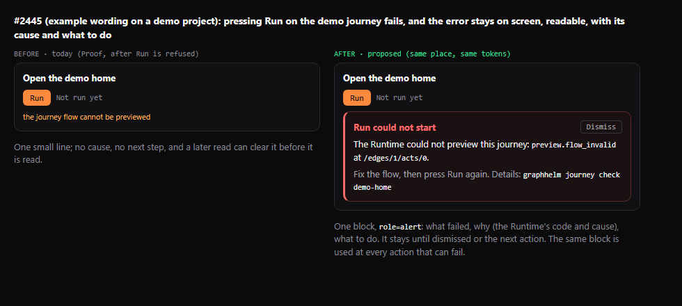

# Failed action alert (#2445)

The owner approved this before/after mock on 2026-11-02 in [the issue comment](https://github.com/stabem/GraphHelm/issues/2445#issuecomment-6576844334):

The same alert appears where a failed action is reported. It names the action, shows the Runtime's known code and safe cause, gives the next step (and a command when one is known), and has a Dismiss button. Dismissing it or starting that action again clears only that action's alert; a successful poll does not.

Runtime details are optional so the Studio continues to work with older Runtime replies. Missing codes and causes stay unknown rather than being guessed. Each caller keeps its own alert, and a late response from an older request must not replace a newer result.

The mock's sample `graphhelm journey check demo-home` text is illustrative. The implemented command uses the verified `graphhelm journey validate --all` route for flow validation failures.
