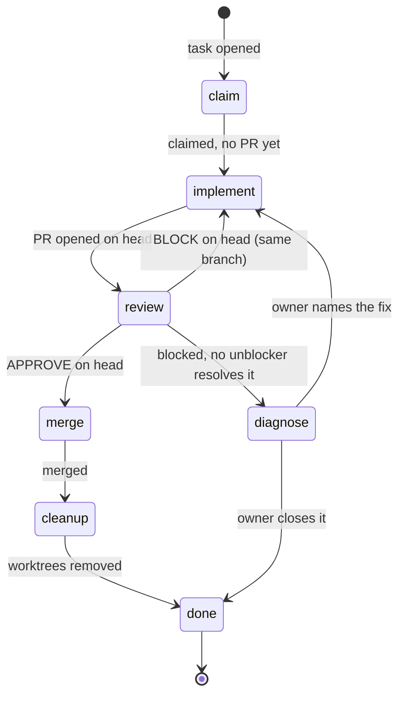

# GraphHelm guide

Read the bundled [GraphHelm guide](../../README.md) and explain only the parts relevant to the user's question. Distinguish shipped behavior from product plans and host discovery from Runtime activation. When a claim depends on the current repository or a live execution, inspect that source before stating it as current.

## Journeys are the proof

GraphHelm develops journey-first (design: `docs/specs/2026-10-07-journey-first-keel-design.md`). A user-visible promise is proven by replaying the journey it touches at the head and seeing its screens, not by a unit test or a status code. Tests are kept for invariants a user cannot see (schemas, digests, concurrency, security). An unavailable observer stays `OBSERVER_MISSING`.

The agent runs the journey; the user never does. Never end work with "try it in the app", "please test" or "vai lá e testa": run the journey observer yourself (Playwright by default; after a deploy, against the deployed site), record the proof, and report what it saw. Only a product decision (approve a design, pick an option) goes to the user. The `handoff_stop_hook.py` Stop hook refuses a reply that hands verification to the user.

Journeys are flows in `.graphhelm/journeys/<id>.journey.yaml` (schema `graphhelm.journey-flow/1`: screens, edges, paths). `graphhelm journey compile` generates the frozen contracts `<contractId>.json`; never edit those by hand. A flow stays `draft` until the owner approves it, in the Studio's Proof view or with `graphhelm journey approve <id> --token-file …`; approval is refused (`flow.preview_not_passed`) until a preview of that exact flow passed (`graphhelm journey preview <id>`, read with `--read`). A blind reviewer lane can record a scoped agent review through the Runtime (`POST /v1/journey-flows/<id>/review` with its own scoped agent credential, after the author lane wrote the draft through `POST /v1/journey-flows/<id>/draft`), but that review never approves: the flow stays a draft until the owner approves it. An agent never approves a flow, except the journey QA agent following the keel plugin's `keel-journey-qa` skill on the owner's explicit delegation, which approves only when all seven of its points pass. The Runtime refuses a reviewer that ever wrote the flow, and a draft no lane wrote through that route. `graphhelm journey replay <id>` walks an approved flow headless with no model call and records sealed captures and walked transitions; `graphhelm journeys` and the Studio's Proof view show each step as fresh, stale or unknown at the head. `graphhelm keel check` warns, without blocking, when a change touches a screen with no fresh capture. Step-by-step with real output: `docs/guides/journeys.md`.

## One task, five steps

Every task runs the same steps after its issue, in any agent host, each a skill that names the record it emits:

1. `task-plan`: paths, promise, proof kind (`journey`, `tests`, `both`, `none`), review count and skills, as one `keel.plan` record.
2. `implement`: the change inside the card under `keel`, with cited context; `test-audit` gates any test.
3. `journey-prove`: replay the touched journeys at the head, keep the first failure of every retry.
4. `blind-review`: one assigned reviewer runs the reached tests and `keel check` on the pinned head and posts the verdict.
5. `merge`: the approving reviewer merges the pinned head, reads back what landed, and releases the workspace.

`graphhelm-kickoff` starts a brand-new project (grill the owner, write the doc and draft flows, then orchestrate the build); `journey-map` creates journeys for an existing project that has none; `journey-contract` adds one for a new behavior. `keel plan` is still being built (`task-plan` says how to write the plan by hand); the `task.*` records each step emits are live. Skills advise; only GraphHelm's deterministic controls validate and publish operational graph changes.

Installing this plugin exposes guidance. It does not install the CLI, start the Runtime, rewrite host customization, activate extension packages, or certify an execution. The `graphhelm-setup` skill covers installing and starting.

## The whole flow, in order

Planned, not shipped (#2582). The plan: one entry skill, `graphhelm-work`, drives every task. A session handed a task would load it, ask GraphHelm for `next`, load the skill it names, do that step, record it, and ask again. Until the Runtime ships `next`, `graphhelm-work` reports `OBSERVER_MISSING` and stops. The planned `next` would be derived from the task's records (`claimed`, `pr_opened`, `review_verdict`, `merged`, `blocked`).

The planned `next` has four fields: `step` (one of `claim`, `implement`, `review`, `merge`, `cleanup`, `done`, `diagnose`), `skill` (the skill to load, or null), `actor` (`{id, role}`; the role is `author`, `reviewer`, `approver`, `merger` or `owner`) and `because` (a fixed reason code plus the record it came from). A null skill would be reported as `OBSERVER_MISSING`, never as success: the session would stop and name the missing skill.

Read the diagram as the plan: each arrow is a planned `next` answer, and its label is the record that would cause it. Ids are meant to match the `step` enum and the journey edge ids; the conformance test in `apps/cli/tests/skill_transitions.rs` checks the step skills' transition tables against this diagram and the declared detours below.

Who acts at each state, as planned (the author never reviews or merges their own work). The skill names are planned; only the ones in the plugin folder exist as files, the rest live in extension folders or are still to write:

| State | Acts | Skill |
|---|---|---|
| `claim` | the author takes the task | `task-plan` |
| `implement` | the author writes and pushes the change | `implement` |
| `review` | one blind reviewer on the pinned head | `blind-review` |
| `merge` | the approving reviewer merges the pinned head | `merge` |
| `cleanup` | the merger removes the PR's worktrees and local branch | `merge` |
| `diagnose` | the owner decides why the task is stuck | none; owner decides |

Declared detours: skill-to-skill rows of the step skills' transition tables that the diagram does not draw.

| From skill | To | When |
|---|---|---|
| `task-plan` | `task-plan` | the plan lacks a proof kind |
| `implement` | `implement` | a BLOCK on your head (same branch, then a new review) |
| `implement` | `journey-prove` | the proof kind is journey or both |
| `journey-prove` | `blind-review` | every approved flow replays green |
| `journey-prove` | `implement` | a step fails on replay |
| `merge` | `blind-review` | the head moved after approval |

A blocked task names its unblocker (`cause`, `unblocker`, `where`, from the owner heartbeat). The unblocker's step becomes the next step, so a BLOCK on a PR sends the author back to `implement` on the same branch with the named defect, and a stall that only the owner can clear goes to `diagnose`.

Every step skill ends with its own transition table (what its record leads to, and who acts next) and sends the session back to `graphhelm-work`. If a session is unsure, it reads the "If in doubt" index at the end of its skill, which is the same in every skill.

The planned proof (not run) is a demo task run end to end by agents that received only `graphhelm-work`: claim, PR, review, BLOCK, fix, APPROVE, merge, cleanup. The conformance test (`apps/cli/tests/skill_transitions.rs`) fails when a transition names a skill that does not exist, or when a transition table and this diagram disagree (a row that is neither an arrow nor a declared detour, or an arrow with no row). The demo does not exist yet.

## Prefer the GraphHelm MCP tools

When the `graphhelm` MCP server is connected, read live state through its tools rather than shelling out (they show as `mcp__graphhelm__*` or `mcp__plugin_graphhelm_graphhelm__*`, depending on the host): `briefing`, `status`, `events`, `evidence`, `resume` and `memory_status`. If neither is connected, use the `graphhelm` CLI with `--json`, and say which source you used. `graphhelm init` registers a project-aware MCP command; `graphhelm setup --resolve home/.claude.json=register-mcp` can install one user-scope entry that resolves the active project by identity. Explicit `--url` and `--token-file` remain available for a deliberately pinned Runtime.

## If in doubt

| Situation | Skill |
|---|---|
| New task, no plan yet | task-plan |
| Writing code for a claimed task | implement |
| Proving a journey | journey-prove |
| Asked to review a PR | blind-review |
| Got a BLOCK on your head | implement (same branch) |
| Approved and you are the reviewer | merge |
| Unsure what the next step is | graphhelm-work (asks GraphHelm next) |
| Unsure about the whole flow | graphhelm-guide |
